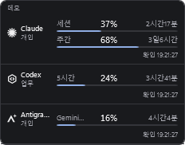
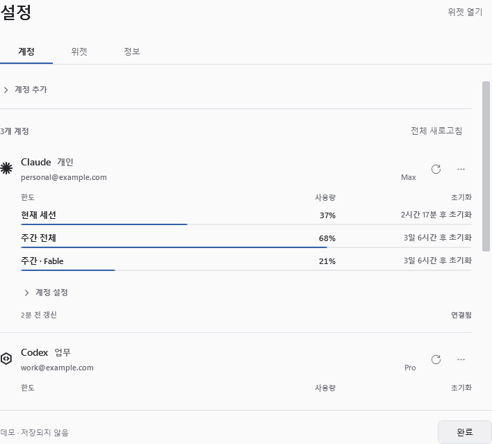

# AI SA

**Your AI subscription usage, right on your desktop.**

**English** · [한국어](README.ko.md)

AI SA is a small Windows widget for keeping an eye on your AI subscription limits. See how much you've used, when your limits reset, and which account needs attention without opening a usage page each time.

Windows 11 x64 · Desktop widget & system tray · Preview 0.4.9

## Screenshots

Screenshots use demo data in the Korean UI. No real account information is shown.

**Desktop widget · Dark theme**

**Settings · Light theme**

## At a glance

- **Usage and reset times.** Percentages, progress bars, and a countdown to each reset. Switch between used and remaining capacity.
- **Choose what matters.** Show multiple limits per account, including Claude's session, overall weekly, and Fable limits when available.
- **A separate tray choice.** Keep session and weekly usage in the widget while showing Fable—or another limit—as the tray number.
- **Stay up to date.** Refresh an account or all accounts manually, or set an automatic interval from 1 minute to 24 hours.
- **Alerts at your chosen threshold.** Enable notifications for individual limits and choose the usage percentage that triggers them.
- **Reset notifications.** In **Settings → Accounts → Account settings → Limit alerts (한도별 알림)**, enable **초기화 알림** for each limit you want to track. A fresh usage check confirms the reset before notifying you once. Reset alerts are off by default and independent of usage threshold alerts.
- **Time-to-limit estimates.** Enable **소진 예상** in **Settings → Widget** to estimate when each limit will run out from recent usage. **위젯에 예상 표시** controls the widget line separately; results remain available in account settings. Forecasting is off by default.
- **Save usage statistics.** Enable **사용량 통계 저장** in **Settings → Widget** to record every successful refresh. Saving, forecasting, and widget display are independent. Turning saving off keeps existing records; **기록 삭제** clears them explicitly.
- **Fit your desktop.** Adjust the size and transparency of the whole widget, use light or dark themes, keep it on top, or lock its position.

Forecasts use saved statistics and need at least three checks spanning ten minutes with a measurable usage increase. They assume your current pace continues and distinguish an earlier reset or insufficient data. Records stay on your PC for up to 24 hours. Turning saving off stops new records; turning forecasting off stops calculation.

The widget stays out of Alt+Tab and the taskbar. It fits its height to the contents when it opens, while keeping your saved width and position. Settings open in a separate window, and optional startup brings AI SA back when you sign in to Windows.

## Services

| Service | What you can track | Accounts |
| --- | --- | --- |
| **Claude** | Session, overall weekly, and additional limits such as Fable, when reported by the service | Multiple |
| **Codex** | Codex limits included with a ChatGPT subscription | Multiple |
| **Antigravity** | Model-specific limits reported by its official tool | Currently signed-in account |
| **Gemini web** | A shortcut to the official website; no automatic usage tracking | — |

AI SA tracks **subscription limits**, rather than API billing or token costs. Antigravity usage is separate from Gemini web usage.

This is a preview. Claude has been checked with a connected Max account. Codex and Antigravity integrations still need validation with signed-in subscription accounts.

## Get started

**Requires Windows 11 on an x64 PC.** The app interface is currently in Korean. [Download the latest published release](https://github.com/osias10/ai-sa-usage/releases/latest).

1. Download and run `AISA-{version}-win-x64-setup.exe` from the release assets. It installs for your Windows user without administrator privileges.
2. Open **Settings (설정) → Accounts (계정) → Add account (계정 추가)** and select a service.
3. Complete the provider's sign-in flow. AI SA prepares the required official tools automatically—no API key, terminal commands, or separate developer tools to set up.
4. Choose the limits you want in **Account settings (계정 설정) → Widget items (위젯 표시 항목)**. Set your tray account and limit separately in the **Widget (위젯)** tab.

The first connection needs internet access and may download several hundred megabytes of tools per service.

## Everyday controls

| To… | Use… |
| --- | --- |
| Open settings | Double-click the widget, or use the tray menu |
| Refresh usage | Press **F5** with the widget focused, or use its right-click menu |
| Adjust transparency | **설정 → 위젯 → 위젯 투명도**; applies to text, icons, gauges, and background |
| Choose the tray number | **설정 → 위젯 → 트레이 표시 계정 / 트레이 표시 항목** |
| Show the last check time | **설정 → 위젯 → 마지막 확인 시간** |
| Bring back a hidden widget | Choose **위젯 열기** from the tray menu |
| Quit AI SA | Choose **종료** from the tray menu |

Changes are saved automatically. At 100% transparency, the whole widget is invisible; the tray menu and settings stay available so you can adjust it again.

## Updates

Starting with **0.4.6**, AI SA checks GitHub for a new stable release once every 24 hours and notifies you once per version. You can turn automatic checks off or check manually in **Settings → Info (정보)**. The tray's **업데이트** menu opens the same screen.

Choose **Download (다운로드)** to download and verify the installer. You can cancel the download and keep using the widget. When ready, choose **Run installer (설치 실행)**: AI SA saves your settings, opens the installation wizard, and exits. Complete the wizard and use its **AI SA 실행** option to reopen the app. Your accounts and widget settings are preserved.

**If you use 0.4.5, install a published version of 0.4.6 or later manually first.** Its update address was not configured, so it cannot discover this first upgrade itself. Pre-releases are not offered by the updater.

## Clear status, local settings

A refresh icon means a check is in progress. An exclamation mark means the account needs attention after the check. If a refresh fails, the widget keeps the last successful values and their timestamp. Missing limits show `—`, and a passed reset time does not turn usage into a guessed 0%.

AI SA runs on your PC without its own backend. Settings and saved usage data stay on your device; sign-in and usage requests use the providers' official tools and services. Checking usage does not send prompts or run model-generation tasks.

For build instructions, integration details, and verification notes, see the [development documentation](DEVELOPMENT.md) (Korean).
